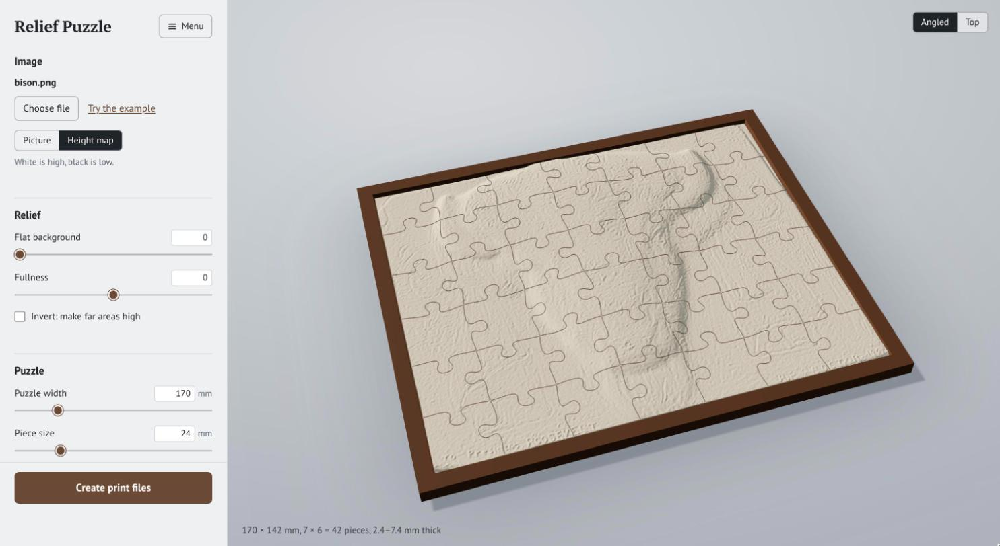
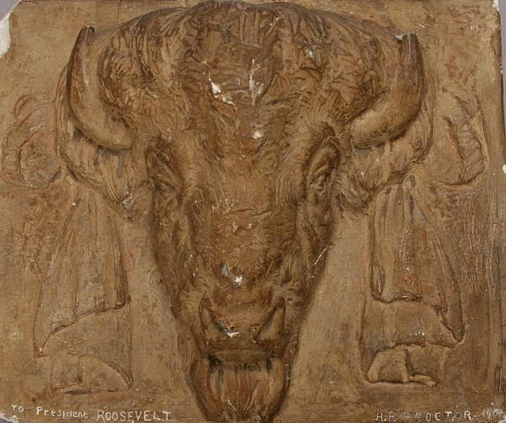
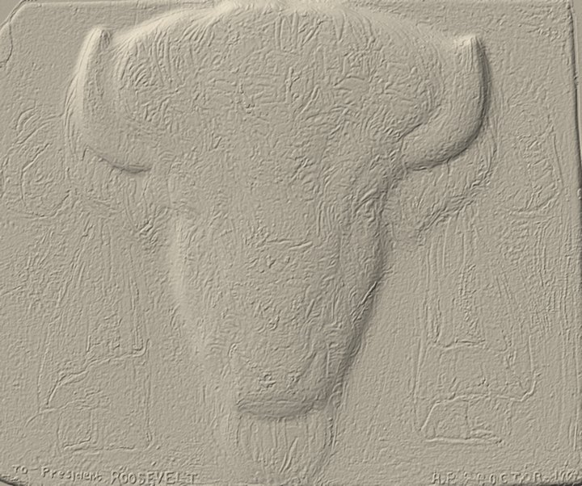
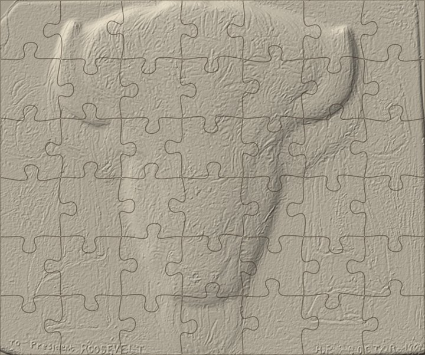
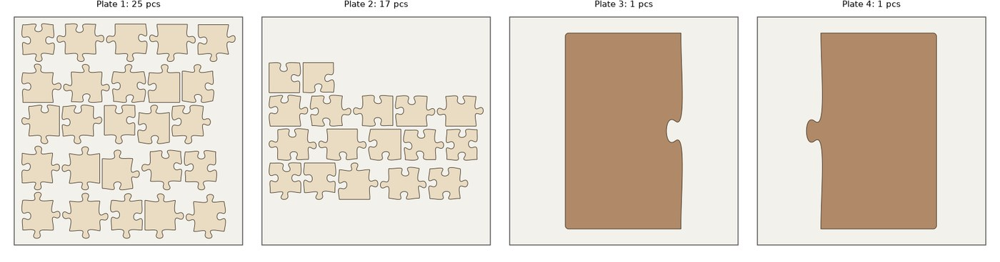
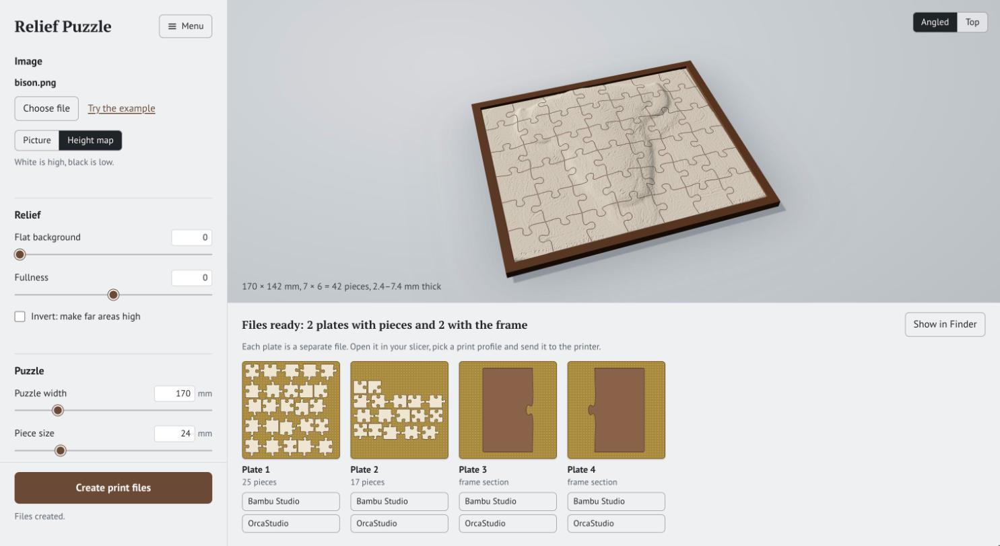
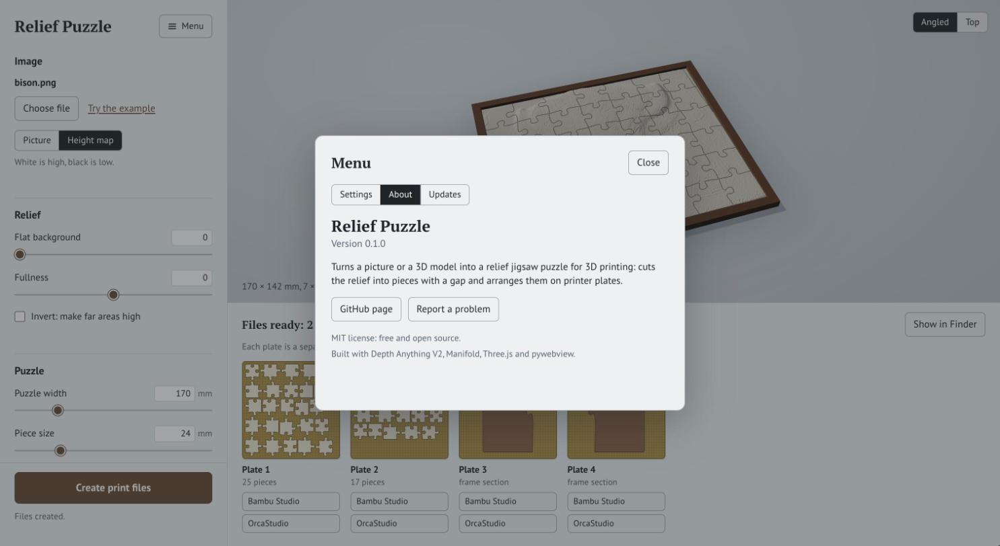

# Relief Puzzle

**English** | [Українська](README.uk.md)

Turn a picture, a height map or a 3D model into a relief jigsaw puzzle you can 3D-print. The app builds the relief, cuts it into interlocking pieces with a print gap, lays the pieces out on printer plates and writes one 3MF file per plate.



## What it does

- **Three kinds of input.** A picture (a neural network estimates its depth), a ready height map (white is high), or a relief 3D model (STL, OBJ, PLY, GLB).
- **Live 3D preview.** Change the width, piece size, relief height or gap and the puzzle redraws at once.
- **Pieces that fit after printing.** Each piece gets an adjustable gap to its neighbours, rounded corners and a small bottom chamfer against elephant's foot.
- **Plates for your printer.** Pieces are packed onto as many plates as the bed size requires (180 mm for a Bambu Lab A1 mini by default). Every plate is a separate 3MF file.
- **A frame.** An optional tray with a rim. If it is larger than the bed, it is split into sections that lock together.
- **A fit test.** Five pairs of pieces with gaps from 0.10 to 0.30 mm, so you can find the right gap for your printer before printing a whole puzzle.
- **English and Ukrainian** interface.

## Example

<p>
  
  
  
</p>

From left to right: the source photo, the relief built from it, and that relief cut into a 170 × 142 mm puzzle of 42 pieces.

The pieces and the two halves of the frame, laid out on 180 mm plates:



Bambu Studio estimates the first plate (25 pieces, 0.12 mm layers, 0.4 mm nozzle, A1 mini) at about 3 h 15 min and 46 g of PLA.

Both source files are in [`examples/`](examples): `bison.jpg` is the photo and `bison_height.png` is the height map made from it.

## Install

You need macOS, Python 3.11 or 3.12, and [uv](https://docs.astral.sh/uv/). The app is tested on macOS with Apple Silicon.

```bash
git clone https://github.com/MykhailoKibkalo/relief-puzzle.git
cd relief-puzzle
uv sync
uv run python app.py
```

To get an icon you can double-click, run this once:

```bash
uv run python make_app.py
```

It creates `Relief Puzzle.app` in the project folder (`Рельєфний пазл.app` if the app language is Ukrainian). You can move the icon to the Dock or to Applications.

The first time you open a picture, the app downloads the depth model from Hugging Face (about 1.3 GB). Height maps and 3D models need no download.

## Using the app

1. Drop a picture, a height map or a 3D model onto the window, or click **Choose file**. **Try the example** loads the bison relief.
2. Adjust the relief and the puzzle. Drag the preview to rotate it.
3. Click **Create print files**. The plates appear at the bottom, each with buttons that open it in Bambu Studio or OrcaStudio if they are installed.



The **Menu** button holds the settings (language, printer bed size, which neural network to use), the version, a link to this page and an update check. If you installed with `git clone`, the app can update itself from there.



### What makes a good source

1. **A relief 3D model** gives the sharpest result: bas-reliefs made for CNC carving, 3D scans, or models from an image-to-3D generator.
2. **A picture that already looks like a relief**: a front view of a plaster or marble bas-relief on a flat background, photographed or AI-generated.
3. **An ordinary photo** works too, but the relief comes out soft and puffy.

The app has no cropping yet, so crop the picture to the subject before opening it.

## Command line

Everything the app does is also available as scripts:

```bash
uv run python heightmap.py photo.jpg -o relief.png      # picture → height map
uv run python mesh2height.py model.stl -o relief.png    # 3D model → height map
uv run python puzzle.py relief.png --width 240 --piece 24 --tray
uv run python puzzle.py --fit-test                      # fit test only
```

The main options of `puzzle.py`:

| Option | Default | Meaning |
|---|---|---|
| `--width` | 170 | Puzzle width in mm; the height follows the aspect ratio |
| `--piece` | 24 | Approximate piece size in mm |
| `--base` | 2.4 | Thickness under the lowest point of the relief, mm |
| `--relief` | 5 | Height of the relief above the base, mm |
| `--clearance` | 0.2 | Gap between neighbouring pieces, mm |
| `--chamfer` | 0.3 | Bottom chamfer against elephant's foot, mm |
| `--bed` | 180 | Printer bed size, mm |
| `--tray` | off | Add the frame |
| `--seed` | 1 | Cut pattern number |

Run any script with `--help` for the full list. Messages follow the app language; set `RELIEF_PUZZLE_LANG=en` or `RELIEF_PUZZLE_LANG=uk` to choose.

## Printing

- **Print the fit test first.** The right gap depends on the printer and the filament. The test takes 20–30 minutes; the number of dots on a piece tells you which gap it has.
- Layers of 0.08–0.12 mm keep the stepping on gentle slopes small. Matte PLA hides layer lines best.
- Print the frame in a second colour.
- The stock Bambu Studio profiles for the A1 mini have elephant foot compensation turned off, which is why the pieces get a bottom chamfer by default.

## How it works

1. **Depth.** Depth Anything V2 runs at two resolutions: the coarse pass gives the overall shape and the fine pass adds detail. Several shifted and mirrored passes are averaged to hide the model's 14-pixel patch grid. Optionally, a little micro-texture is mixed in from the image brightness.
2. **Relief.** The height map becomes a height-field solid on a 0.2 mm grid.
3. **Cutting.** The cut lines are classic jigsaw tabs built from cubic Bézier curves. Each piece outline is inset by half the gap, and the piece is the intersection of the height-field solid with the extruded outline, computed with [Manifold](https://github.com/elalish/manifold).
4. **Layout.** Pieces are shelf-packed onto plates and written straight to 3MF.

## Limits

- Depth estimated from a photo captures the overall shape; fine detail such as fur or feathers comes out soft. The **Surface texture** control imitates it from image brightness, which is not real geometry.
- The app window, the icon and the slicer buttons are macOS-only. The command-line scripts are plain Python and should run elsewhere, but that is untested.
- The geometry is checked: every piece is a closed solid, and the plates slice without errors in Bambu Studio 2.8. The default 0.2 mm gap has not been validated on real prints yet, so use the fit test.

## License and credits

The code is released under the [MIT license](LICENSE).

- **Depth models.** [Depth Anything V2](https://github.com/DepthAnything/Depth-Anything-V2): the Small model is Apache 2.0; the Large model, used by default, is CC BY-NC 4.0, which means non-commercial use only. If you sell prints, switch to the basic network in Menu → Settings or pass `--model small`.
- **Bundled.** [Three.js](https://threejs.org) (MIT) in `static/vendor/`.
- **Dependencies.** Manifold, trimesh, pywebview, PyTorch and Transformers, under their own licenses.
- **Jigsaw tabs.** The tab shape follows the Bézier parametrization known from [Draradech's jigsaw generator](https://github.com/Draradech/jigsaw).
- **Example image.** A plaster model of a bison head by Alexander Phimister Proctor (1909); photo by the U.S. National Park Service (NPGallery), public domain, via [Wikimedia Commons](https://commons.wikimedia.org/wiki/File:Plaster_model_of_a_bison_head_sculpted_by_Alexander_Phimister_Proctor_and_given_to_Theodore_Roosevelt._In_1909,_Theodore_(ff31c65e-b5ed-488a-bc8e-11a34399b3c4).JPG).
