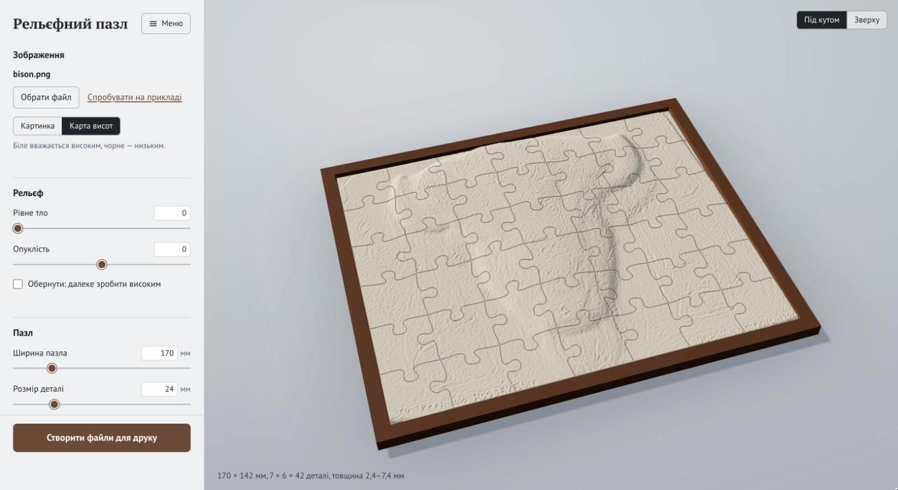
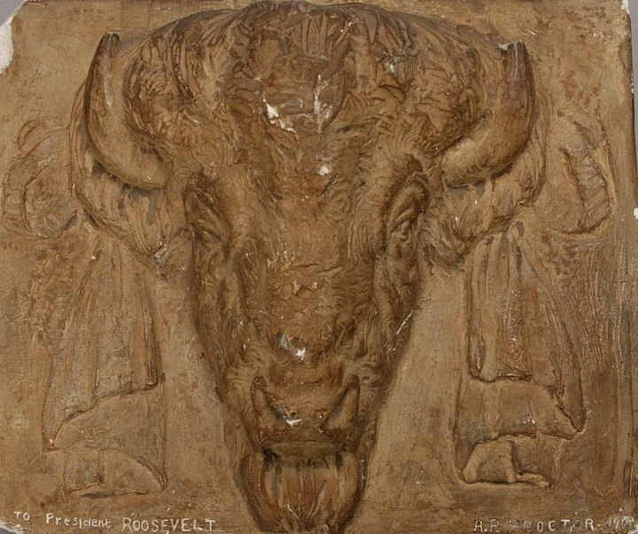
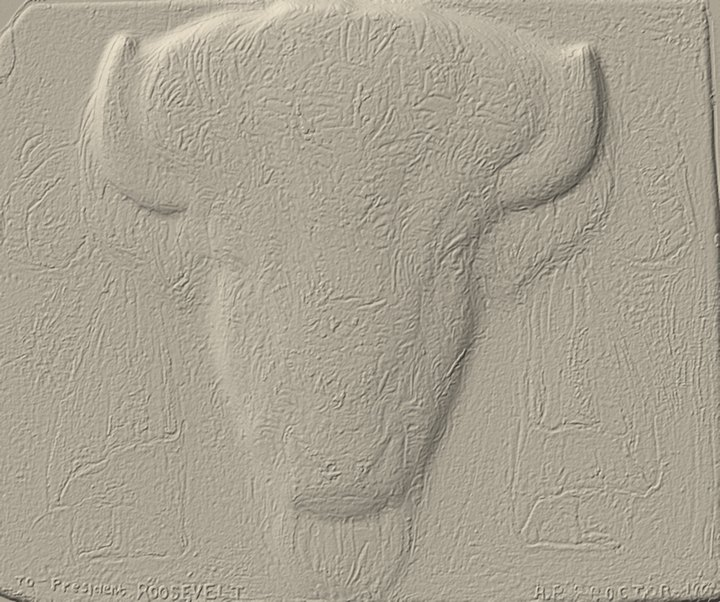
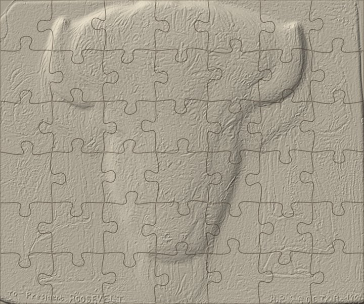
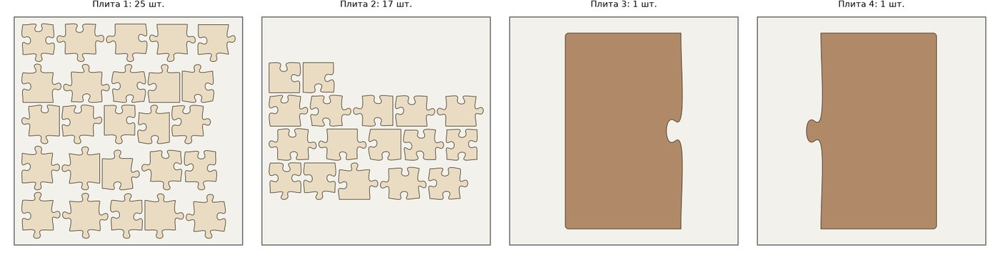
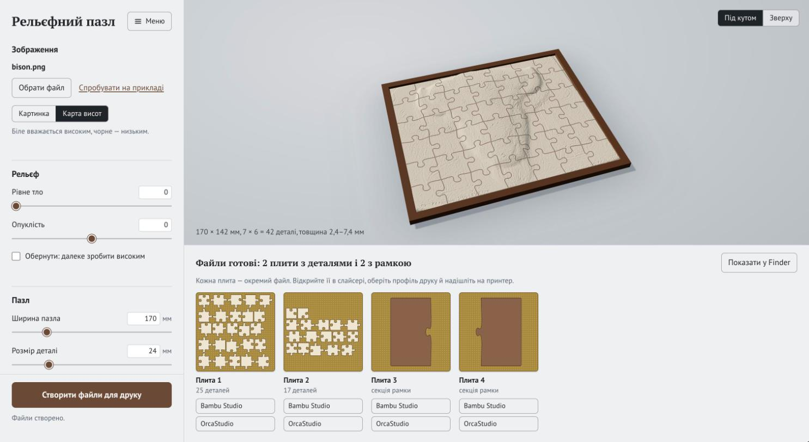
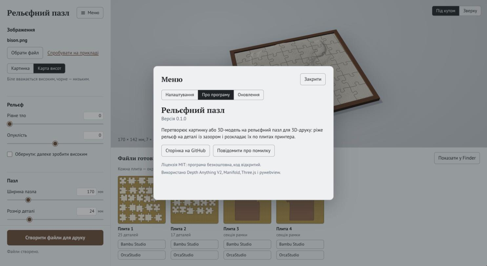

# Рельєфний пазл

[English](README.md) | **Українська**

Перетворює картинку, карту висот або 3D-модель на рельєфний пазл, який можна надрукувати на 3D-принтері. Застосунок будує рельєф, ріже його на деталі із замками й зазором, розкладає деталі по плитах принтера і зберігає окремий файл 3MF для кожної плити.



## Що він уміє

- **Три види вхідних файлів.** Картинка (глибину оцінює нейромережа), готова карта висот (біле — високо) або 3D-модель рельєфу (STL, OBJ, PLY, GLB).
- **Живий 3D-перегляд.** Змінюєте ширину, розмір деталі, висоту рельєфу чи зазор, і пазл одразу перемальовується.
- **Деталі, які складаються після друку.** Кожна деталь має зазор до сусідніх, округлені кути й невелику фаску знизу проти «слонячої ноги».
- **Плити під ваш принтер.** Деталі розкладаються на стільки плит, скільки потрібно для заданого розміру столу (типово 180 мм, як у Bambu Lab A1 mini). Кожна плита — окремий файл 3MF.
- **Рамка.** За бажанням додається піддон із бортиком. Якщо він більший за стіл, то ріжеться на секції із замками.
- **Тест посадки.** П'ять пар деталей із зазорами від 0,10 до 0,30 мм, щоб підібрати зазор для свого принтера до друку цілого пазла.
- **Українська й англійська** мови інтерфейсу.

## Приклад

<p>
  
  
  
</p>

Зліва направо: вихідне фото, побудований за ним рельєф і той самий рельєф, розрізаний на пазл 170 × 142 мм із 42 деталей.

Деталі й дві половини рамки на плитах 180 мм:



За оцінкою Bambu Studio, перша плита (25 деталей, шар 0,12 мм, сопло 0,4 мм, A1 mini) друкується приблизно 3 год 15 хв і бере 46 г PLA.

Обидва вихідні файли лежать у теці [`examples/`](examples): `bison.jpg` — фото, `bison_height.png` — зроблена з нього карта висот.

## Встановлення

Потрібні macOS, Python 3.11 або 3.12 і [uv](https://docs.astral.sh/uv/). Застосунок перевірено на macOS з Apple Silicon.

```bash
git clone https://github.com/MykhailoKibkalo/relief-puzzle.git
cd relief-puzzle
uv sync
uv run python app.py
```

Щоб мати значок для запуску подвійним кліком, один раз виконайте:

```bash
uv run python make_app.py
```

У теці проєкту з'явиться `Рельєфний пазл.app` (або `Relief Puzzle.app`, якщо мова застосунку англійська). Значок можна перенести в Dock або в «Програми».

Коли ви вперше відкриєте картинку, застосунок завантажить нейромережу з Hugging Face (близько 1,3 ГБ). Для карт висот і 3D-моделей нічого завантажувати не треба.

## Як користуватися

1. Перетягніть у вікно картинку, карту висот або 3D-модель чи натисніть **Обрати файл**. Кнопка **Спробувати на прикладі** відкриває барельєф бізона.
2. Налаштуйте рельєф і пазл. Перегляд можна обертати мишею.
3. Натисніть **Створити файли для друку**. Унизу з'являться плити, під кожною — кнопки, що відкривають її в Bambu Studio або OrcaStudio, якщо вони встановлені.



За кнопкою **Меню** — налаштування (мова, розмір столу принтера, вибір нейромережі), версія, посилання на цю сторінку й перевірка оновлень. Якщо застосунок встановлено через `git clone`, він уміє оновлюватися звідти сам.



### Яке джерело дає найкращий результат

1. **3D-модель рельєфу** дає найчіткіший результат: барельєфи для різьблення на ЧПК, 3D-скани, моделі з генераторів «картинка → 3D».
2. **Картинка, що вже схожа на рельєф**: гіпсовий чи мармуровий барельєф, знятий строго спереду на рівному тлі; фото або згенероване зображення.
3. **Звичайне фото** теж працює, але рельєф виходить м'яким і «надутим».

Обрізати картинку в застосунку поки не можна, тож обріжте її до сюжету заздалегідь.

## Командний рядок

Усе, що робить застосунок, доступне й окремими скриптами:

```bash
uv run python heightmap.py photo.jpg -o relief.png      # картинка → карта висот
uv run python mesh2height.py model.stl -o relief.png    # 3D-модель → карта висот
uv run python puzzle.py relief.png --width 240 --piece 24 --tray
uv run python puzzle.py --fit-test                      # лише тест посадки
```

Основні параметри `puzzle.py`:

| Параметр | Типово | Що означає |
|---|---|---|
| `--width` | 170 | Ширина пазла, мм; висота береться за пропорцією |
| `--piece` | 24 | Орієнтовний розмір деталі, мм |
| `--base` | 2.4 | Товщина під найнижчою точкою рельєфу, мм |
| `--relief` | 5 | Висота рельєфу над основою, мм |
| `--clearance` | 0.2 | Зазор між сусідніми деталями, мм |
| `--chamfer` | 0.3 | Фаска знизу проти «слонячої ноги», мм |
| `--bed` | 180 | Розмір столу принтера, мм |
| `--tray` | вимкнено | Додати рамку |
| `--seed` | 1 | Номер малюнка розрізу |

Повний перелік показує `--help` у кожному скрипті. Повідомлення йдуть мовою застосунку; її можна задати змінною `RELIEF_PUZZLE_LANG=uk` або `RELIEF_PUZZLE_LANG=en`.

## Друк

- **Спершу надрукуйте тест посадки.** Потрібний зазор залежить від принтера й пластику. Тест друкується 20–30 хвилин; кількість крапок на деталі показує, який у неї зазор.
- Шар 0,08–0,12 мм робить сходинки на пологих схилах малопомітними. Матовий PLA найкраще ховає шари.
- Рамку варто надрукувати іншим кольором.
- У стандартних профілях Bambu Studio для A1 mini компенсацію «слонячої ноги» вимкнено, тому деталі типово мають фаску знизу.

## Як це працює

1. **Глибина.** Depth Anything V2 запускається на двох роздільностях: грубий прохід дає загальну форму, детальний додає дрібниці. Кілька проходів зі зсувом і віддзеркаленням усереднюються, щоб сховати сітку моделі з клітинок 14 × 14 пікселів. За бажанням підмішується трохи мікрофактури з яскравості картинки.
2. **Рельєф.** Карта висот стає тілом на сітці з кроком 0,2 мм.
3. **Розріз.** Лінії розрізу — класичні пазлові замки з кубічних кривих Безьє. Контур кожної деталі зсувається всередину на половину зазору, а сама деталь — це перетин рельєфного тіла з призмою за цим контуром; рахує його [Manifold](https://github.com/elalish/manifold).
4. **Розкладка.** Деталі пакуються на плити рядами й одразу записуються у 3MF.

## Обмеження

- Глибина, оцінена з фото, передає загальну форму; дрібні деталі на кшталт шерсті чи пір'я виходять м'якими. Повзунок **Фактура поверхні** імітує їх з яскравості картинки, але це не справжня геометрія.
- Вікно застосунку, значок і кнопки слайсерів працюють лише на macOS. Командні скрипти — звичайний Python і мали б працювати деінде, але це не перевірено.
- Геометрію перевірено: кожна деталь — замкнене тіло, а плити без помилок нарізаються в Bambu Studio 2.8. Типовий зазор 0,2 мм ще не перевірено на справжніх відбитках, тому скористайтеся тестом посадки.

## Ліцензія та подяки

Код поширюється за [ліцензією MIT](LICENSE).

- **Нейромережі глибини.** [Depth Anything V2](https://github.com/DepthAnything/Depth-Anything-V2): модель Small має ліцензію Apache 2.0; модель Large, яка використовується типово, — CC BY-NC 4.0, тобто лише для некомерційного використання. Якщо ви продаєте відбитки, оберіть просту нейромережу в «Меню → Налаштування» або додайте `--model small`.
- **У складі репозиторію.** [Three.js](https://threejs.org) (MIT) у `static/vendor/`.
- **Залежності.** Manifold, trimesh, pywebview, PyTorch і Transformers, кожна зі своєю ліцензією.
- **Пазлові замки.** Форма замків повторює параметризацію кривими Безьє, відому з [генератора пазлів Draradech](https://github.com/Draradech/jigsaw).
- **Зображення-приклад.** Гіпсова модель голови бізона роботи Александера Фімістера Проктора (1909); фото Служби національних парків США (NPGallery), суспільне надбання, з [Wikimedia Commons](https://commons.wikimedia.org/wiki/File:Plaster_model_of_a_bison_head_sculpted_by_Alexander_Phimister_Proctor_and_given_to_Theodore_Roosevelt._In_1909,_Theodore_(ff31c65e-b5ed-488a-bc8e-11a34399b3c4).JPG).
